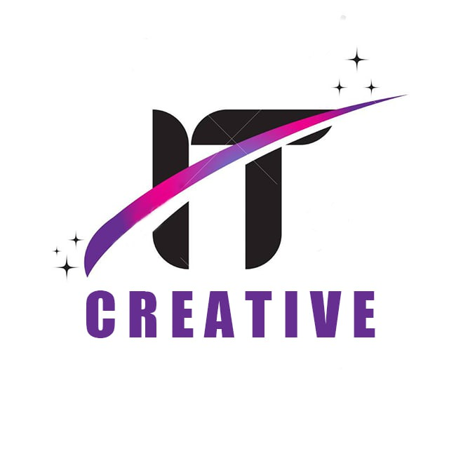

<p align="center">
  
</p>

<h1 align="center">IT Creative Academy LMS</h1>

<p align="center">
  <strong>A Django learning management system built for IT training centers in Uzbekistan</strong><br/>
  <sub>Students · Teachers · Parents · Administrators · Assistant administrators</sub>
</p>

<p align="center">
  <a href="README.md">🇺🇿 Özbekça</a> •
  <a href="README.en.md">🇬🇧 English</a>
</p>

<p align="center">
  <a href="https://www.python.org/downloads/"></a>
  <a href="https://www.djangoproject.com/"></a>
  <a href="https://www.django-rest-framework.org/"></a>
  <a href="LICENSE"></a>
  <a href="https://github.com/Xusanbek0039/learning-managment-sistem-django/stargazers"></a>
  <a href="https://github.com/Xusanbek0039/learning-managment-sistem-django/issues"></a>
</p>

<p align="center">
  <a href="https://itc-academy.uz">🌐 Live site</a> •
  <a href="docs/INSTALLATION.md">⚙️ Install</a> •
  <a href="docs/API.md">📡 API</a> •
  <a href="SECURITY.md">🔐 Security</a> •
  <a href="CONTRIBUTING.md">🤝 Contribute</a> •
  <a href="docs/ROADMAP.md">🗺 Roadmap</a>
</p>

---

## Contents

- [About](#about)
- [Features](#features)
- [Technology stack](#technology-stack)
- [Architecture](#architecture)
- [Roles](#roles)
- [Quick start](#quick-start)
- [Database](#database)
- [Environment variables](#environment-variables)
- [REST API](#rest-api)
- [Testing](#testing)
- [Deployment](#deployment)
- [Documentation](#documentation)
- [Contributing](#contributing)
- [Security](#security)
- [License](#license)
- [Maintainer](#maintainer)

## About

**IT Creative Academy LMS** is the learning management system developed for, and used in daily
operation by, the IT Creative training center (Zomin, Uzbekistan). It has separate panels for
students, teachers, parents, administrators and assistant administrators.

- **Live site:** <https://itc-academy.uz>
- **Users (as reported by the maintainer, Nov 2026):** ~350 students, 20 teachers, 150 parents,
  5 administrators, 3 assistant administrators.
- **UI language:** Uzbek. The codebase uses its own Latin orthography for Uzbek
  (`ö`, `ğ`, `ş`, `ç`; see `accounts/alphabet.py`). Code identifiers are English.

> This repository must not contain real user data. For local work, create an empty database
> (see below). Found a vulnerability? Please follow [SECURITY.md](SECURITY.md).

## Features

| Area | What it does |
|------|--------------|
| 📚 Learning | Courses, sections, lessons (video, homework, tests, vocabulary, speaking), study groups, attendance |
| 🤖 AI | OpenAI-based assistant, AI-assisted homework review |
| 🪙 Coins | Earn coins, shop, peer-to-peer transfers, activity rewards |
| 🎮 Games | Typing challenge, word game, chess/checkers, competitions, external games API |
| 📝 Blog | News and articles with likes and comments |
| 🤖 Telegram bot | OTP login, notifications, AI chat, broadcasts |
| 👨‍👩‍👧 Parent portal | Child progress, payments, messaging teachers, Android app API |
| 💳 Payments | Payme, Click, Tezcheck and inPAY integrations, balances |
| 📊 Certificates | Generated PDF certificates verifiable by CERT-ID |
| 💬 Chat | Group chats, direct messages, reactions, replies, pins |
| 📋 Surveys | Dynamic survey builder (8 question types) |
| 📖 Library | Book rentals, reminders, return tracking |
| 🏆 Gamification | XP/levels, streaks, achievements, leaderboards |
| 📱 Apps | Android (student and parent) and Windows clients in `ilovalar/` |

## Technology stack

| Layer | Technology |
|-------|------------|
| Backend | Python 3.10+, Django 5.1, Django REST Framework 3.15, Jazzmin admin |
| Database | SQLite (development and the current production setting) |
| Static files | WhiteNoise, `collectstatic` into `staticfiles/` |
| Libraries | Pillow, ReportLab (PDF), openpyxl (Excel), OpenAI SDK, requests, argon2-cffi, youtube-transcript-api |
| Optional | Redis via `django-redis` (off by default), psycopg2 (not used by the active settings) |
| Frontend | Django templates, Bootstrap 5, Bootstrap Icons, vanilla JS, Quill.js, Chart.js, GSAP/Three.js on some pages (CDN) |
| Hosting | cPanel + Phusion Passenger (`passenger_wsgi.py`), Nginx (Engintron) |

## Architecture

A single Django project (`config/`) with 14 local apps. `accounts` is the core: users, courses,
lessons, payments, chat, attendance and most of the HTML views. Other apps: `teacher`, `parents`,
`api`, `ai_yordamchi`, `coin`, `games`, `blog`, `telegram_bot`, `quiz`, `video_quiz`, `kurslarim`,
`startup` and `backup`. See [docs/ARCHITECTURE.md](docs/ARCHITECTURE.md).

## Roles

| Role | Stored as | Summary |
|------|-----------|---------|
| Administrator | `CustomUser.role = 'admin'` | Full management: users, courses, payments, reports, broadcasts, maintenance mode |
| Assistant administrator | `role = 'assistant_admin'` + `AssistantRole` | Granular permissions granted by an admin; actions are audit-logged |
| Teacher | `role = 'teacher'` | Lessons in own courses, homework grading, attendance, salary view, certificates |
| Student | `role = 'student'` | Courses, lessons, tests, homework, AI assistant, coins, games, certificates |
| Parent | separate `parents` model (not a Django user) | Separate login, child progress, payments, messages, Android app |

## Quick start

Full guide: **[docs/INSTALLATION.md](docs/INSTALLATION.md)**. Developer workflow: [docs/DEVELOPMENT.md](docs/DEVELOPMENT.md).

```bash
git clone https://github.com/Xusanbek0039/learning-managment-sistem-django.git
cd learning-managment-sistem-django
python -m venv .venv
# Windows: .venv\Scripts\activate    Linux/macOS: source .venv/bin/activate
pip install -r requirements.txt -r requirements-dev.txt
cp .env.example .env               # then edit .env (minimal values below)
python manage.py migrate           # no makemigrations needed, migrations are committed
python manage.py createsuperuser
python manage.py runserver
```

Minimal local `.env`:

```env
DEBUG=True
DJANGO_SECRET_KEY=<random local key>
ALLOWED_HOSTS=127.0.0.1,localhost
SITE_URL=http://127.0.0.1:8000
SECURE_SSL_REDIRECT=False
```

> ⚠️ The `db.sqlite3` in the repository is tracked for historical reasons and will be removed.
> Do not use it. Rename or delete your local copy and run `migrate` to get a clean database.

## Database

- Active setting: SQLite at `BASE_DIR / 'db.sqlite3'` (`timeout=30`, `transaction_mode='IMMEDIATE'`,
  WAL enabled in `accounts/apps.py`).
- The `DB_ENGINE`/`DB_NAME`/... variables are **not read** by the current settings (that block is
  commented out). Configurable databases (SQLite path / PostgreSQL) are on the roadmap.
- Backups: `python manage.py send_backup`. See [docs/BACKUP.md](docs/BACKUP.md) (Uzbek).

## Environment variables

Every key, with comments, is listed in **[`.env.example`](.env.example)**. Never commit real values.
Main groups: Django core (`DJANGO_SECRET_KEY`, `DEBUG`, `ALLOWED_HOSTS`, `SITE_URL`, `ADMIN_URL`,
`CSRF_TRUSTED_ORIGINS`), HTTPS/proxy, email, OpenAI/YouTube, Telegram, reCAPTCHA, payment providers
(`PAYME_*`, `CLICK_*`, `TEZCHECK_*`, `INPAY_*`), OAuth (Google/Facebook/GitHub), backup, and cache/worker
switches. With `DEBUG=False` and no `DJANGO_SECRET_KEY`, the app refuses to start on purpose.

## REST API

Base path `/api/v1/`, token (`Authorization: Token <key>`) or session auth, `IsAuthenticated` by
default, 20 items per page, JSON only. Full endpoint list: **[docs/API.md](docs/API.md)**.

## Testing

```bash
python manage.py check
python manage.py test
node --test "tests/*.test.cjs" # JavaScript unit tests (Node 22+)
```

Tests should never reach the network. Keep real tokens out of your local `.env`, or use the isolated
settings pattern in [docs/DEVELOPMENT.md](docs/DEVELOPMENT.md). CI workflows live in `.github/workflows/`.

## Deployment

Production runs on cPanel + Passenger. The server-side procedure is [`deploy.sh`](deploy.sh):
database backup → `git pull --ff-only` → `pip install` (only when requirements change) → `migrate` →
`collectstatic` → restart. Run `python manage.py check --deploy` against your production `.env`.
See [docs/INSTALLATION.md](docs/INSTALLATION.md#production).

## Documentation

[Installation](docs/INSTALLATION.md) · [Development](docs/DEVELOPMENT.md) · [Architecture](docs/ARCHITECTURE.md) ·
[API](docs/API.md) · [Roadmap](docs/ROADMAP.md) · [Licensing](docs/LICENSING.md) · [Changelog](CHANGELOG.md)

## Contributing

Read **[CONTRIBUTING.md](CONTRIBUTING.md)** and look for issues labelled
[`good first issue`](https://github.com/Xusanbek0039/learning-managment-sistem-django/labels/good%20first%20issue).
Everyone taking part is expected to follow the [Code of Conduct](CODE_OF_CONDUCT.md).

## Security

Please **do not open public issues for vulnerabilities**. Follow [SECURITY.md](SECURITY.md).

## License

The project code is released under the [MIT License](LICENSE). Third-party libraries, fonts and
assets keep their own licenses; see [docs/LICENSING.md](docs/LICENSING.md).

## Maintainer

**Husanbek Suyunov**, Full-Stack Developer and founder of IT Creative Zomin.
GitHub: [@Xusanbek0039](https://github.com/Xusanbek0039) · Website: <https://itc-academy.uz>
