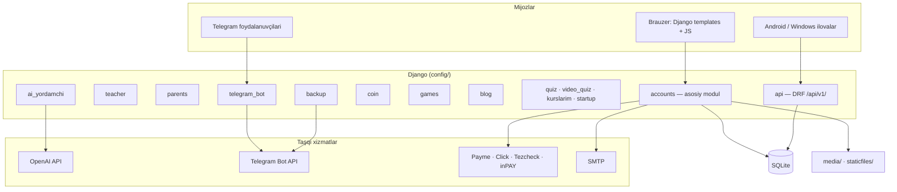

<p align="center">
  
</p>

<h1 align="center">IT Creative Academy LMS</h1>

<p align="center">
  <strong>Özbekiston IT ta'lim markazlari uçun Django asosidagi ta'lim boşqaruv tizimi (LMS)</strong><br/>
  <sub>Öquvçi · Öqituvçi · Ota-ona · Admin · Yordamçi admin</sub>
</p>

<p align="center">
  <a href="README.md">🇺🇿 Özbekça</a> •
  <a href="README.en.md">🇬🇧 English</a>
</p>

<p align="center">
  <a href="https://www.python.org/downloads/"></a>
  <a href="https://www.djangoproject.com/"></a>
  <a href="https://www.django-rest-framework.org/"></a>
  <a href="LICENSE"></a>
  <a href="https://github.com/Xusanbek0039/learning-managment-sistem-django/stargazers"></a>
  <a href="https://github.com/Xusanbek0039/learning-managment-sistem-django/issues"></a>
</p>

<p align="center">
  <a href="https://itc-academy.uz">🌐 Jonli sayt</a> •
  <a href="docs/INSTALLATION.md">⚙️ Örnatiş</a> •
  <a href="docs/API.md">📡 API</a> •
  <a href="SECURITY.md">🔐 Xavfsizlik</a> •
  <a href="CONTRIBUTING.md">🤝 Hissa qöşiş</a> •
  <a href="docs/ROADMAP.md">🗺 Roadmap</a>
</p>

---

## 📋 Mundarija

- [Loyiha haqida](#-loyiha-haqida)
- [Asosiy imkoniyatlar](#-asosiy-imkoniyatlar)
- [Texnologiyalar](#-texnologiyalar)
- [Arxitektura](#-arxitektura)
- [Foydalanuvçi rollari](#-foydalanuvçi-rollari)
- [Ilovalar (Apps)](#-ilovalar-apps)
- [Tezkor boşlaş (lokal)](#-tezkor-boşlaş-lokal)
- [Ma'lumotlar bazasi](#-malumotlar-bazasi)
- [Muhit özgaruvçilari](#-muhit-özgaruvçilari)
- [REST API](#-rest-api)
- [Xavfsizlik](#-xavfsizlik)
- [Telegram bot](#-telegram-bot)
- [Testlaş](#-testlaş)
- [Deploy](#-deploy)
- [Loyiha tuzilişi](#-loyiha-tuzilişi)
- [Hujjatlar](#-hujjatlar)
- [Roadmap](#-roadmap)
- [Hissa qöşiş](#-hissa-qöşiş)
- [Litsenziya](#-litsenziya)
- [Muallif](#-muallif)

---

## 📖 Loyiha haqida

**IT Creative Academy LMS** — IT Creative (Zomin) öquv markazi uçun işlab çiqilgan va real
ta'lim jarayonida işlatilayotgan ta'lim boşqaruv tizimi. Tizimda öquvçilar, öqituvçilar,
ota-onalar, adminlar va yordamçi adminlar uçun alohida panellar bor.

- **Jonli sayt:** <https://itc-academy.uz>
- **Foydalanuvçilar (maintainer ma'lumoti, 2026-11):** ~350 öquvçi, 20 öqituvçi, 150 ota-ona,
  5 admin, 3 yordamçi admin.
- **Interfeys tili:** özbekça (loyiha öz lotin yozuvi variantini işlatadi — `accounts/alphabet.py`).

> Bu repozitoriyada **real foydalanuvçi ma'lumotlari yöq bölişi kerak**. Lokal işlaş uçun böş
> baza yarating (pastga qarang). Xavfsizlik muammosini topsangiz — [SECURITY.md](SECURITY.md).

## ✨ Asosiy imkoniyatlar

| Yönaliş | Imkoniyatlar |
|---------|--------------|
| 📚 **Ta'lim** | Kurslar, bölimlar, darslar (video, uyga vazifa, test, luğat, speaking), öquv guruhlari, davomat |
| 🤖 **Sun'iy intellekt** | OpenAI asosidagi AI yordamçi, uy vazifalarini AI bilan tekşiriş |
| 🪙 **Coin iqtisodiyoti** | Coin qölga kiritiş, dökon, P2P transfer, faollik mukofotlari |
| 🎮 **Öyinlar** | Typing challenge, söz öyini, shaxmat/shashka, musobaqalar, taşqi öyinlar API |
| 📝 **Blog** | Yangiliklar, maqolalar, like va izohlar |
| 🤖 **Telegram bot** | OTP login, bildirişnomalar, AI çat, ommaviy xabarlar |
| 👨‍👩‍👧 **Ota-ona portali** | Farzand progressi, tölovlar, öqituvçi bilan aloqa, Android ilova API |
| 💳 **Tölovlar** | Payme, Click, Tezcheck, inPAY integratsiyalari, balans |
| 📊 **Sertifikatlar** | Avtomatik PDF sertifikat, CERT-ID bilan tekşiriş |
| 💬 **Çat** | Guruh çat, şaxsiy xabarlar, reaksiyalar, reply, pin |
| 📋 **Sörovnomalar** | Dinamik sörovnoma (8 xil savol turi) |
| 📖 **Kutubxona** | Kitob ijarasi, eslatmalar, qaytariş kuzatuvi |
| 🏆 **Gamifikatsiya** | XP/level, streak, yutuqlar, reyting |
| 📱 **Ilovalar** | Android (öquvçi va ota-ona) va Windows mijozlari — `ilovalar/` |

## 🛠 Texnologiyalar

| Qatlam | Texnologiya |
|--------|-------------|
| Backend | Python 3.10+ · Django 5.1 · Django REST Framework 3.15 · Jazzmin admin |
| Ma'lumotlar bazasi | SQLite (dev va hozirgi production sozlamasi) |
| Statik fayllar | WhiteNoise · `collectstatic` → `staticfiles/` |
| Kutubxonalar | Pillow · ReportLab (PDF) · openpyxl (Excel) · OpenAI SDK · requests · argon2-cffi · youtube-transcript-api |
| Ixtiyoriy | Redis (`django-redis`, default öçiq) · psycopg2 (hozir faol settings işlatmaydi) |
| Frontend | Django templates · Bootstrap 5 · Bootstrap Icons · Vanilla JS · Quill.js · Chart.js · GSAP/Three.js (ayrim sahifalar, CDN) |
| Hosting | cPanel + Phusion Passenger (`passenger_wsgi.py`), Nginx (Engintron) |

To'liq ro'yxat: [`requirements.txt`](requirements.txt), [`requirements-dev.txt`](requirements-dev.txt).

## 🏗 Arxitektura



Batafsil: [docs/ARCHITECTURE.md](docs/ARCHITECTURE.md).

## 👥 Foydalanuvçi rollari

### 🔴 Admin
- Töliq tizim boşqaruvi
- Öquvchi/öqituvchi qöşiş va boşqariş
- Kurslar, darslar, testlar yaratiş
- Tölovlarni boşqariş va monitoring
- Tizim statistikasi va hisobotlar (PDF/Excel)
- Ommaviy xabar yuboriş (Telegram + tizim içida)
- Maintenance mode boşqaruvi
- Xavfsizlik hodisalarini kuzatiş

### 🟡 Yordamçi admin
- Granular permission tizimi (AssistantRole modeli)
- Admin tomonidan belgilangan vakolatlar doirasida işlaş
- Harakatlar audit log bilan kuzatiladi

### 🟢 Öqituvçi
- Öz kurslaridagi darslarni boşqariş
- Uyga vazifalarni tekşiriş va baholaş
- Öquvçi progressini kuzatiş
- Maoş va davomat köriş
- Sertifikatlarni boşqariş
- Öquvçilar bilan çat

### 🔵 Öquvçi
- Kurslarga yoziliş va darslarni örganiş
- Video darslar, testlar, uyga vazifalar
- AI yordamçidan foydalaniş
- Coin yiğiş va dökonda sarflaş
- Öyinlar va musobaqalarda qatnaşiş
- Sertifikat oliş
- Blog yoziş va boşqalar bilan muloqot

### 🟣 Ota-ona
- Alohida portal (Django User emas, mustaqil model)
- Farzand progressini real-time kuzatiş
- Test natijalari va baholaş
- Tölov tarixi
- Öqituvçi bilan xabar almaşiş
- Kitob ijarasi köriş

## 📦 Ilovalar (Apps)

### 1. `accounts` — Asosiy modul

> Tizimning eng katta va asosiy moduli. 50+ model, 600KB+ views.

**Asosiy modellar:**

| Model | Vazifasi |
|-------|----------|
| `CustomUser` | Foydalanuvçilar (admin, teacher, student, assistant_admin) |
| `Profession` | Kurslar va kasblar (pullik/bepul, sertifikatli, AI tekşiruv) |
| `Section` | Kurs bölimlari (tartiblanuvçi) |
| `Lesson` | Darslar (video, homework, test, dictionary, speaking) |
| `VideoLesson` | Video darslar (YouTube/Vimeo) |
| `Homework` / `HomeworkSubmission` | Uyga vazifalar va topşiriqlar |
| `Test` / `TestQuestion` / `TestResult` | Test tizimi (lesson, midterm, practice, final) |
| `Certificate` | Sertifikatlar (CERT-YYYYMMDD-XXXX format) |
| `PaymentStatus` / `PaymentRecord` | Tölov kuzatuvi |
| `StudentBalance` | Balans tizimi (auto-deduction) |
| `Message` | Tizim içki bildiriş nomalari (12 tur) |
| `UserDevice` / `UserSession` | Qurilma va sessiya boşqaruvi |
| `GroupChatMessage` / `DirectMessage` | Çat tizimi |
| `SurveyForm` / `SurveyQuestion` | Sörovnoma tizimi |
| `PaymeTransaction` / `ClickTransaction` | Tölov gateway integratsiya |
| `SecurityEvent` | Xavfsizlik hodisalari log |
| `Book` / `BookRental` | Kutubxona tizimi |
| `Parent` / `ParentMessage` | Ota-ona modeli va xabarlar |
| `AssistantRole` / `AssistantActionLog` | Yordamçi admin roli va audit |

---

### 2. `teacher` — Öqituvçi paneli

| Model | Vazifasi |
|-------|----------|
| `TeacherCertificate` | Öqituvçi sertifikatlari |
| `TeacherSalary` | Maoş (oylik, KPI, bonus, jarima, bayram) |
| `TeacherAttendance` | Davomat (keldi, kelmadi, keç qoldi, kasal, ta'til) |

---

### 3. `parents` — Ota-ona portali

Alohida login tizimi bilan farzandlar progressini kuzatiş, tölov tarixi, öqituvçi bilan aloqa.

---

### 4. `api` — REST API (DRF)

```
/api/v1/token/              — Autentifikatsiya token olish
/api/v1/status/             — API holati
/api/v1/profile/            — Profil ma'lumotlari
/api/v1/profile/complete/   — Profil to'ldirish
/api/v1/courses/            — Kurslar (faqat öqiş)
/api/v1/admin/students/     — O'quvchilar ro'yxati (admin)
/api/v1/coin/               — Coin operatsiyalari
/api/v1/reyting/            — Reyting/leaderboard
```

**Konfiguratsiya:** Token + Session auth, PageNumberPagination (20/sahifa), JSON renderer, coin_transfer throttle (10/min).

---

### 5. `ai_yordamchi` — AI yordamçi

| Model | Vazifasi |
|-------|----------|
| `ChatSession` | Foydalanuvçi AI çat sessiyalari |
| `ChatMessage` | Xabarlar (user/assistant), rasm va fayl qöllab-quvvatlash |

OpenAI GPT asosida kurs mavzulari böyiça savol-javob. Har bir sörov uçun coin sarflanadi.

---

### 6. `coin` — Coin iqtisodiyoti va dökon

| Model | Vazifasi |
|-------|----------|
| `Product` | Dökon mahsulotlari (nom, narx, zaxira) |
| `ProductLike` / `ProductComment` | Like va izohlar |
| `ProductPurchase` | Xarid tarixi (pending/delivered/cancelled) |
| `CoinTransaction` | Tranzaksiya logi (add/remove/purchase) |
| `CoinTransfer` | P2P transfer (10% komissiya, tasdiqlaş kodi) |
| `ActivityLog` | Faollik kuzatuvi (17 xil harakat turi) |

---

### 7. `games` — Öyinlar va musobaqalar

| Model | Vazifasi |
|-------|----------|
| `Game` | Öyin turlari (typing, quiz, word_builder, external) |
| `Prompt` | Typing challenge matnlari (qiyinlik darajali) |
| `Competition` | Musobaqalar (coin mukofotlar: 1/2/3 örin) |
| `GameAttempt` | Typing natijalar (WPM, aniqlik, ball) |
| `BoardMatch` | Multiplayer öyinlar (shaxmat/shashka, coin tikiş) |
| `WordRound` / `WordGameAttempt` | Söz öyini |
| `GameProgress` / `UserAchievement` | XP/level/yutuqlar tizimi |

> 🔒 **Xavfsizlik:** HMAC asosida natijalar tekşiruvi (cheat prevention).

---

### 8. `blog` — Yangiliklar va maqolalar

| Model | Vazifasi |
|-------|----------|
| `Post` | Maqolalar (news, tutorial, tips, announcement) |
| `PostLike` / `PostComment` | Like va izohlar (coin mukofotli) |
| `CommentLike` | Izoh likelari |

---

### 9. `telegram_bot` — Telegram bot

| Model | Vazifasi |
|-------|----------|
| `TelegramLoginCode` | OTP login kodlari (6 raqamli, 5 daqiqa) |
| `TelegramLinkToken` | Akkaunt boğlaş tokenlari |
| `TelegramMessageLog` | Kiruvçi xabarlar logi |
| `ContactMessage` | Saytdan aloqa xabarlari |
| `TelegramBroadcastMessage` | Ommaviy xabar yuboriş |
| `TelegramChatState` | Foydalanuvçi holati (AI çat, contact mode) |

### Boşqa ilovalar

| Ilova | Vazifasi |
|-------|----------|
| `quiz` | Quiz moduli (sahifalar `/quiz/`, API `/api/v1/quiz/`) |
| `video_quiz` | Video içidagi savollar (`/video-quiz/`) |
| `kurslarim` | "Kurslarim" sahifalari (`/kurslarim/`) |
| `startup` | Startap loyihalar va roadmap (`/startup/`) |
| `backup` | Kunlik DB backup va Telegramga yuboriş ([docs/BACKUP.md](docs/BACKUP.md)) |

## ⚡ Tezkor boşlaş (lokal)

Batafsil qöllanma: **[docs/INSTALLATION.md](docs/INSTALLATION.md)** · dasturçi ish oqimi: [docs/DEVELOPMENT.md](docs/DEVELOPMENT.md).

```bash
git clone https://github.com/Xusanbek0039/learning-managment-sistem-django.git
cd learning-managment-sistem-django
python -m venv .venv
# Windows: .venv\Scripts\activate    Linux/macOS: source .venv/bin/activate
pip install -r requirements.txt -r requirements-dev.txt
cp .env.example .env               # keyin .env ni tahrirlang (pastga qarang)
python manage.py migrate           # makemigrations SHART EMAS — migratsiyalar repoda bor
python manage.py createsuperuser
python manage.py runserver
```

Lokal `.env` uçun minimal qiymatlar:

```env
DEBUG=True
DJANGO_SECRET_KEY=<lokal tasodifiy kalit>
ALLOWED_HOSTS=127.0.0.1,localhost
SITE_URL=http://127.0.0.1:8000
SECURE_SSL_REDIRECT=False
```

> ⚠️ Repodagi `db.sqlite3` tarixiy sabablarga köra tracked va kelajakda olib taşlanadi.
> Uni işlatmang: `.env` bilan böş baza yarating yoki fayl nomini özgartirib yangidan `migrate` qiling.

## 🗄 Ma'lumotlar bazasi

- Faol sozlama: `config/settings.py` → `DATABASES['default']` = **SQLite** (`BASE_DIR / 'db.sqlite3'`),
  `timeout=30`, `transaction_mode='IMMEDIATE'`, WAL rejimi (`accounts/apps.py`).
- `DB_ENGINE`, `DB_NAME`, `DB_USER`... özgaruvçilari **hozir öqilmaydi** (settings'da izohga olingan blok).
  PostgreSQL'ga ötiş — roadmap'da ([docs/ROADMAP.md](docs/ROADMAP.md)).
- Backup: `python manage.py send_backup` — [docs/BACKUP.md](docs/BACKUP.md).

## 🔑 Muhit özgaruvçilari

Barça kalitlar nomi va izohlari: **[`.env.example`](.env.example)**. Real qiymatlarni hech qaçon commit qilmang.

| Guruh | Asosiy özgaruvçilar |
|-------|---------------------|
| Django core | `DJANGO_SECRET_KEY` (yoki `SECRET_KEY`), `DEBUG`, `ALLOWED_HOSTS`, `SITE_URL`, `ADMIN_URL`, `CSRF_TRUSTED_ORIGINS` |
| HTTPS / proxy | `SECURE_SSL_REDIRECT`, `SECURE_HSTS_SECONDS`, `USE_X_FORWARDED_FOR`, `TRUSTED_PROXY_COUNT` |
| Email | `EMAIL_BACKEND`, `EMAIL_HOST`, `EMAIL_PORT`, `EMAIL_USE_TLS`, `EMAIL_HOST_USER`, `EMAIL_HOST_PASSWORD`, `DEFAULT_FROM_EMAIL` |
| AI / media | `OPENAI_API_KEY`, `YOUTUBE_API_KEY` |
| Telegram | `TELEGRAM_BOT_TOKEN`, `TELEGRAM_BOT_USERNAME`, `TELEGRAM_GROUP_CHAT_ID`, `TELEGRAM_WEBHOOK_SECRET`, `TELEGRAM_HEALTH_TOKEN` |
| Himoya | `RECAPTCHA_SITE_KEY`, `RECAPTCHA_SECRET_KEY`, `LOGIN_MAX_ATTEMPTS`, `LOGIN_LOCKOUT_DURATION`, `GAME_HMAC_SECRET` |
| Tölovlar | `PAYME_*`, `CLICK_*`, `TEZCHECK_*`, `INPAY_*` |
| OAuth | `GOOGLE_CLIENT_ID/SECRET`, `FACEBOOK_APP_ID/SECRET`, `GITHUB_CLIENT_ID/SECRET` (+ `*_REDIRECT_URI`) |
| Backup | `BACKUP_TELEGRAM_BOT_TOKEN`, `BACKUP_TELEGRAM_CHAT_ID`, `BACKUP_DIR`, `BACKUP_RETENTION_DAYS`... |
| Kesh / işçilar | `USE_REDIS_CACHE`, `USE_FILE_CACHE`, `FILE_CACHE_DIR`, `REDIS_*`, `RUN_INPROCESS_WORKERS`, `RUN_STARTUP_TEMPLATE_REPAIR` |

> `DEBUG=False` va `DJANGO_SECRET_KEY` yöq bölsa — ilova ataylab işga tuşmaydi (`ImproperlyConfigured`).

## 📡 REST API

Baza: `/api/v1/` · Auth: `Authorization: Token <token>` yoki session · Default ruxsat: `IsAuthenticated` ·
Paginatsiya: 20 ta/sahifa · Javob: JSON. **To'liq ro'yxat: [docs/API.md](docs/API.md).**

| Metod | Endpoint | Tavsif |
|-------|----------|--------|
| `POST` | `/api/v1/token/` | Token oliş (username + password) |
| `GET` | `/api/v1/status/` | API holati |
| `GET` | `/api/v1/profile/` | Joriy foydalanuvçi profili |
| `GET` | `/api/v1/courses/` · `/api/v1/courses/<id>/` | Kurslar |
| `GET` | `/api/v1/my/enrollments/` · `/my/test-results/` · `/my/certificates/` | Öquvçi ma'lumotlari |
| `GET` | `/api/v1/admin/students/` | Öquvçilar (admin) |
| — | `/api/v1/coin/` · `/reyting/` · `/startup/` · `/assistant/` · `/library/` · `/quiz/` | Modul API'lari |
| — | `/api/v1/app/...` · `/api/v1/parent-app/...` | Mobil ilovalar API |
| `POST` | `/api/v1/games/external/verify/` · `/result/` · `/mp/*` · `/gx/*` | Taşqi öyinlar API |

## 🔐 Xavfsizlik

Zaiflikni **ommaviy issue sifatida oçmang** — [SECURITY.md](SECURITY.md) dagi tartib böyiça xabar bering.

### Middleware zanjiri (tartib böyiça)

```
1.  SecurityMiddleware              — Django o'rnatilgan xavfsizlik
2.  RequestSizeLimitMiddleware      — >20MB so'rovlarni bloklash
3.  GlobalRateLimitMiddleware       — DDoS / brute-force himoya
4.  WhiteNoiseMiddleware            — Statik fayllar
5.  SessionMiddleware               — Session boshqaruvi
6.  CommonMiddleware                — URL normalizatsiya
7.  CsrfViewMiddleware              — CSRF himoya
8.  AuthenticationMiddleware        — Autentifikatsiya
9.  MessageMiddleware               — Flash xabarlar
10. XFrameOptionsMiddleware         — Clickjacking himoya
11. SecurityHeadersMiddleware       — CSP, HSTS headerlari
12. MaintenanceMiddleware           — Texnik xizmat rejimi
13. BlockedUserMiddleware           — Bloklangan foydalanuvchilar
14. SessionTimeoutMiddleware        — 2 soatlik session timeout
15. DeviceLimitMiddleware           — Qurilma soni cheklovi
16. ProfileCompletionMiddleware     — Profil to'ldirish majburiyati
17. SectionBlockMiddleware          — Bo'limlar blokirovkasi
18. UpdateLastActivityMiddleware    — Faollik kuzatuvi
19. PaymentCheckMiddleware          — To'lov tekshiruvi
20. BirthdayCheckMiddleware         — Tug'ilgan kun tabrik
21. PremiumExpiryMiddleware         — Premium muddati tekshiruvi
```

### Xavfsizlik çoralari

| Himoya | Tavsif |
|--------|--------|
| **Parol haşlaş** | PBKDF2 (default) + Argon2 (agar örnatilgan bölsa) |
| **HTTPS** | HSTS 1 yil (production), SSL redirect, secure cookies |
| **CSP** | Content Security Policy — XSS hujumlardan himoya |
| **CSRF** | SameSite=Lax, HttpOnly cookies |
| **Session** | DB-backed, custom cookie (`itc_sid`), 2 soat muddatli |
| **Login himoya** | 5 ta uriniş, 15 daqiqa blokirovka |
| **Fayl yuklaş** | Max 10MB (fayl), Max 20MB (umumiy) |
| **Öyin xavfsizligi** | HMAC-based natija tekşiruvi |
| **Logging** | Rotating file handler (5MB × 10 fayl) |
| **Qurilma boşqaruvi** | Qurilma limiti, işonçli qurilma tizimi |

### Xavfsizlik hodisalari

Tizim 17 xil xavfsizlik hodisasini 4 darajada (info, warning, error, critical) kuzatadi va `logs/security.log` fayliga yozadi.

## 🤖 Telegram bot

### Imkoniyatlari

| Funksiya | Tavsif |
|----------|--------|
| 🔑 **OTP Login** | 6 raqamli kod bilan tezkor kiriş (5 daqiqa amal qiladi) |
| 🔗 **Akkaunt boğlaş** | Telegram hisobni LMS hisobiga ulaş |
| 📢 **Bildirişnomalar** | Yangi dars, uyga vazifa, test natijalari haqida xabar |
| 📨 **Ommaviy xabar** | Barça / öquvçilar / öqituvçilar / guruh / individual |
| 🤖 **AI çat** | Telegram orqali AI yordamçidan foydalaniş |
| 📞 **Aloqa** | Sayt orqali aloqa xabarlari (loginsiz) |
| ✨ **Premium emoji** | Premium animatsiyali emoji va stikerlar |

### Bot sozlamalari

```env
TELEGRAM_BOT_TOKEN=your-bot-token
TELEGRAM_BOT_USERNAME=your_bot_username
TELEGRAM_GROUP_CHAT_ID=-100xxxxxxxxxx
SITE_URL=https://your-domain.uz
```

> ⚠️ `SITE_URL` böş yoki `*` bölsa — bot lokal **polling** rejimida işlaydi. Production uçun real domen kerak (**webhook** rejimi).

### Webhook sozlaş

```
POST https://api.telegram.org/bot<TOKEN>/setWebhook
?url=https://your-domain.uz/telegrambotlms/webhook/
```

## 🧪 Testlaş

```bash
python manage.py check
python manage.py test                       # barça Django testlari
python manage.py test accounts.tests_security accounts.tests_security_payments
node --test "tests/*.test.cjs"           # JS unit testlar (Node 22+)
```

Testlar tarmoqqa çiqmasligi kerak: `.env` da real tokenlarni qoldirmang yoki alohida test settings işlating
([docs/DEVELOPMENT.md](docs/DEVELOPMENT.md#testlar--tests)). CI: `.github/workflows/`.

## 🚀 Deploy

Production hozir cPanel + Passenger muhitida. Server tomonidagi tartib [`deploy.sh`](deploy.sh) da:
baza zaxirasi → `git pull --ff-only` → (kerak bölsa) `pip install` → `migrate` → `collectstatic` → restart.

Production `.env` uçun majburiy: `DEBUG=False`, kuçli `DJANGO_SECRET_KEY`, aniq `ALLOWED_HOSTS` va
`CSRF_TRUSTED_ORIGINS`, `SECURE_SSL_REDIRECT=True`, `SECURE_HSTS_SECONDS>0`. Tekşiriş: `python manage.py check --deploy`.
Tezlik, Nginx/Passenger va backup: [docs/performance.md](docs/performance.md), [docs/BACKUP.md](docs/BACKUP.md),
[docs/INSTALLATION.md](docs/INSTALLATION.md#production).

## 📁 Loyiha tuzilişi

```
learning-managment-sistem-django/
│
├── config/                     # Django loyiha konfiguratsiyasi
│   ├── settings.py             # Asosiy sozlamalar
│   ├── urls.py                 # URL marshrutlash
│   ├── wsgi.py                 # WSGI konfiguratsiya
│   └── asgi.py                 # ASGI konfiguratsiya
│
├── accounts/                   # 📋 Asosiy modul (foydalanuvchilar, kurslar, to'lovlar)
│   ├── models.py               # 50+ model (2500+ qator)
│   ├── views.py                # Asosiy views (600KB+)
│   ├── middleware.py           # 15+ custom middleware
│   ├── security.py             # Xavfsizlik yordamchilari
│   ├── notifications.py       # Bildirishnomalar (tizim + Telegram)
│   ├── permissions_registry.py # Ruxsat tizimi
│   ├── payment_views.py       # Payme & Click to'lov viewlari
│   ├── parent_views.py        # Ota-ona viewlari
│   ├── yordamchi_views.py     # Yordamchi admin viewlari
│   ├── forms.py                # Formalar
│   ├── admin.py                # Admin panel konfiguratsiya
│   └── urls.py                 # URL marshrutlash
│
├── teacher/                    # 👨‍🏫 O'qituvchi paneli
│   ├── models.py               # Sertifikat, maosh, davomat
│   ├── views.py                # O'qituvchi viewlari
│   └── urls.py
│
├── parents/                    # 👨‍👩‍👧 Ota-ona portali
│   ├── portal_views.py         # Portal viewlari
│   ├── portal_urls.py          # Portal URL'lari
│   └── urls.py
│
├── api/                        # 📡 REST API
│   ├── urls.py                 # API endpointlar
│   ├── views.py                # API viewlari
│   ├── assistant/              # Yordamchi admin API
│   ├── coin/                   # Coin API
│   └── reyting/                # Reyting API
│
├── ai_yordamchi/               # 🤖 AI yordamchi (OpenAI)
│   ├── models.py               # ChatSession, ChatMessage
│   ├── views.py                # AI chat viewlari
│   └── urls.py
│
├── coin/                       # 🪙 Coin iqtisodiyoti va do'kon
│   ├── models.py               # Product, Transaction, Transfer
│   ├── views.py                # Do'kon viewlari
│   └── urls.py
│
├── games/                      # 🎮 O'yinlar va musobaqalar
│   ├── models.py               # Game, Competition, BoardMatch
│   ├── views.py                # O'yin viewlari
│   └── urls.py
│
├── blog/                       # 📝 Blog va yangiliklar
│   ├── models.py               # Post, PostLike, PostComment
│   ├── views.py                # Blog viewlari
│   └── urls.py
│
├── telegram_bot/               # 📱 Telegram bot
│   ├── models.py               # LoginCode, BroadcastMessage
│   ├── utils.py                # Bot API funksiyalari
│   ├── premium.py              # Premium emoji/stiker
│   └── urls.py
│
├── templates/                  # 🎨 Shablonlar
│   ├── landing.html            # Landing sahifa
│   ├── 403.html / 404.html / 500.html  # Xato sahifalar
│   └── 403_csrf.html
│
├── static/                     # 📦 Statik fayllar (CSS, JS, images)
├── staticfiles/                # 📦 collectstatic natijalari
├── media/                      # 📁 Foydalanuvchi yuklagan fayllar
├── logs/                       # 📋 Log fayllar
│
├── manage.py                   # Django boshqaruv skripti
├── requirements.txt            # Python kutubxonalar
├── passenger_wsgi.py           # cPanel deploy
├── .env.example                # Muhit o'zgaruvchilari namunasi (.env — faqat lokal, git'da emas)
├── .htaccess                   # Apache konfiguratsiya
├── robots.txt                  # SEO - qidiruv botlari
└── sitemap.xml                 # SEO - sayt xaritasi
```

## 📊 URL marşrut xaritasi

| Prefiks | Ilova | Tavsif |
|---------|-------|--------|
| `/` | `accounts` | Asosiy sahifalar (login, dashboard, kurslar) |
| `/` | `coin` | Dökon va coin operatsiyalari |
| `/admin/` | Django Admin | Jazzmin admin paneli |
| `/api/v1/` | `api` | REST API endpointlar |
| `/ai/` | `ai_yordamchi` | AI yordamçi |
| `/teacher/` | `teacher` | Öqituvçi paneli |
| `/yordamchi/` | `accounts` | Yordamçi admin sahifalari |
| `/dashboard/parents/` | `parents` | Ota-onalar (admin körinişi) |
| `/parent/` | `parents` | Ota-ona portali |
| `/blog/` | `blog` | Blog va yangiliklar |
| `/games/` | `games` | Öyinlar |
| `/telegrambotlms/` | `telegram_bot` | Telegram webhook |

## 📚 Hujjatlar

| Hujjat | Mazmuni |
|--------|---------|
| [docs/INSTALLATION.md](docs/INSTALLATION.md) | Örnatiş (lokal va production) |
| [docs/DEVELOPMENT.md](docs/DEVELOPMENT.md) | Dasturçi ish oqimi, testlar, demo ma'lumotlar |
| [docs/ARCHITECTURE.md](docs/ARCHITECTURE.md) | Arxitektura, ilovalar, middleware, rollar |
| [docs/API.md](docs/API.md) | REST API |
| [docs/ROADMAP.md](docs/ROADMAP.md) | Roadmap va open-source rivojlantiriş rejasi |
| [docs/LICENSING.md](docs/LICENSING.md) | Litsenziya va uçinçi tomon komponentlari |
| [docs/BACKUP.md](docs/BACKUP.md) · [docs/performance.md](docs/performance.md) | Operatsion qöllanmalar |
| [docs/EMAIL_SETUP.md](docs/EMAIL_SETUP.md) · [docs/TEZCHECK_SETUP.md](docs/TEZCHECK_SETUP.md) · [docs/INPAY_SETUP.md](docs/INPAY_SETUP.md) | Integratsiyalar |
| [CHANGELOG.md](CHANGELOG.md) | Özgarişlar tarixi |

## 🗺 Roadmap

Qisqaça (batafsil: [docs/ROADMAP.md](docs/ROADMAP.md)):

- [ ] Maxfiy fayllar va real ma'lumotlarni repodan butunlay olib taşlaş
- [ ] Django 5.2 LTS va xavfsiz bog'liqlik versiyalariga ötiş
- [ ] Xavfsiz demo ma'lumot yaratuvçi buyruq (`seed_demo`)
- [ ] Bazani env orqali sozlaş (SQLite yöli / PostgreSQL)
- [ ] Docker bilan lokal muhit
- [ ] Ingliz tilidagi interfeys (i18n) kengaytiriş
- [x] Android va Windows ilovalar · Redis kesh (ixtiyoriy) · kunlik backup

## 🤝 Hissa qöşiş

Hissa qöşmoqçimisiz? **[CONTRIBUTING.md](CONTRIBUTING.md)** ni öqing. Boşlaş uçun
[`good first issue`](https://github.com/Xusanbek0039/learning-managment-sistem-django/labels/good%20first%20issue)
belgili vazifalarni qidiring. Barça iştirokçilar [CODE_OF_CONDUCT.md](CODE_OF_CONDUCT.md) ga amal qiladi.

## 📄 Litsenziya

Loyiha kodi [MIT litsenziyasi](LICENSE) ostida tarqatiladi. Uçinçi tomon kutubxonalari, şriftlar va
aktivlar öz litsenziyalariga ega — [docs/LICENSING.md](docs/LICENSING.md).

## 👨‍💻 Muallif

<p align="center">
  <strong>Husanbek Suyunov</strong><br/>
  <em>Full-Stack Developer | IT Creative Zomin asosçisi</em>
</p>

<p align="center">
  <a href="https://github.com/Xusanbek0039"></a>
  <a href="https://itc-academy.uz"></a>
</p>

---

<p align="center">
  <sub>© 2024-2026 Suyunov Husan | IT Creative Zomin. Kod <a href="LICENSE">MIT</a> litsenziyasi ostida.</sub>
</p>

